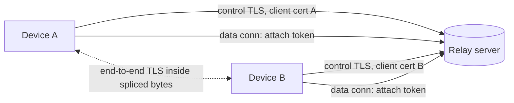
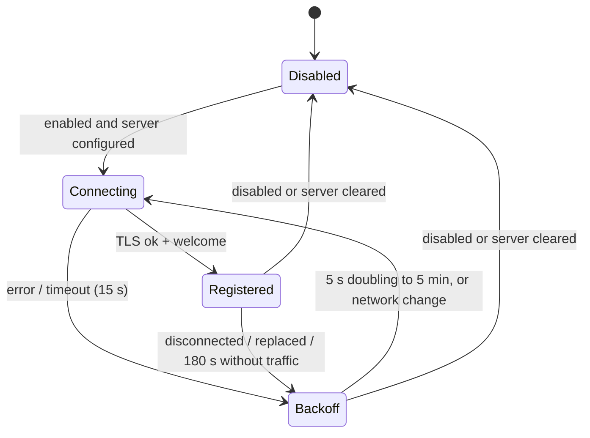
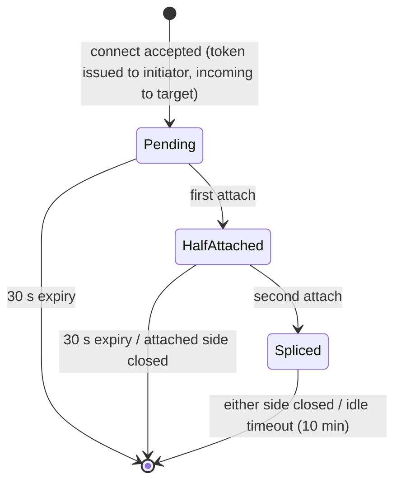

<!--
SPDX-FileCopyrightText: 2026 meatybot <avatarcc@tuta.io>
SPDX-License-Identifier: AGPL-3.0-or-later
-->

# Relay protocol, version 1

This is the protocol `kdeconnect-relayserver` speaks. The KDE Connect desktop client
([meatybot/kdeconnect-kde](https://github.com/meatybot/kdeconnect-kde), `core/backends/relay`) and
the Android client ([meatybot/kdeconnect-android](https://github.com/meatybot/kdeconnect-android),
`backends/relay`) implement the client side. How the clients use the relay inside KDE Connect
(pairing, settings, connect by key or fingerprint) is specified in `docs/specs/relay.md` of those
repositories.

The relay lets two devices that are not on the same network reach each other. It gives every
registered device a short *relay key* derived from its public key, and splices byte tunnels
between two devices on request. The devices run an end-to-end TLS session inside the tunnel and
pin each other's certificates, so the relay only ever forwards ciphertext.

Non-goals: NAT traversal, federation between relays, accounts, listing online devices, and hiding
metadata (who talks to whom, when, how much) from the relay operator.

## Terminology

- *Fingerprint*: SHA-256 over the DER encoding of the device's X.509 certificate, written as 64
  lowercase hex characters. Input may contain `:`/spaces and any case. This is the value shown by
  "Encryption info" on both platforms.
- *Relay key*: first 100 bits of SHA-256 over the DER `SubjectPublicKeyInfo` of the device
  certificate's public key, encoded with the RFC 4648 base32 alphabet (`A-Z2-7`), 20 characters,
  shown in 5 groups of 4 separated by `-`. Input is case-insensitive; `-`, spaces and `=` are
  ignored. Example: `ULJO-GBWQ-G4X3-LFX5-N5SH`.
- *Target*: what the user types: a relay key (20 base32 chars after normalization) or a
  fingerprint (64 hex chars after normalization). Anything else is rejected.

Test vector (committed as `tests/data/relay-test-vector.pem`. This repository, the KDE Connect desktop client and the Android client all assert these values):

| Value | Result |
|---|---|
| fingerprint | `fc1fb3d3d33b2342e45c74b1a613dcdfe5e1f029d668249f504952a9a8041e31` |
| SHA-256(SPKI) | `a2d2e306d0372fb596fd6f647a05d6b79054b5ee052ea58171efc3144d54fe8c` |
| relay key | `ULJO-GBWQ-G4X3-LFX5-N5SH` |

The key is computed by the client and by the server independently. Clients never trust a key the
server reports for a peer; they verify the peer certificate inside the end-to-end TLS session.

## Architecture



The relay listens on a single TCP port (default `1765`). The first line a client sends on a new
connection selects its kind:

- `{"type":"hello","version":1}`: a *control connection*. The server answers
  `{"type":"starttls"}` and both sides start TLS (the client is the TLS client). The server uses
  its own certificate and requests a client certificate (not chain-verified); without one the
  connection is closed. The client certificate identifies the device. The client must not send
  anything after `hello` before it receives `starttls`.
- `{"type":"attach","token":"..."}`: a *data connection* carrying a single-use tunnel token.
  Once both sides of the token attach, the server splices bytes.
- Anything else, or no complete line within 10 s: the connection is closed.

Data connections are plain TCP on purpose: the devices immediately start their own TLS session
inside it. Nesting that TLS session inside a second TLS layer to the relay would add no
confidentiality (the relay could read the outer layer anyway), and Qt cannot run one TLS socket
inside another. The tunnel token is only delivered over the authenticated control TLS
connection or over the already established end-to-end link.

## Wire protocol

All messages are single-line UTF-8 JSON objects terminated by `\n`, at most 8192 bytes, with a
mandatory string field `type`. Unknown fields are ignored. Unknown `type` values from a newer
client are answered with `error`/`bad_request` and otherwise ignored. Protocol version is `1`.

### Control connection: server to client

`welcome`, sent right after the TLS handshake:

```json
{"type":"welcome","version":1,"key":"ULJO-GBWQ-G4X3-LFX5-N5SH","fingerprint":"fc1f...1e31"}
```

`tunnel`, reply to a `connect` request:

```json
{"type":"tunnel","requestId":"7","token":"5b0c6c0e2f5d4d6a9e1f3a7b8c9d0e1f","purpose":"link",
 "peerKey":"ABCD-...","peerFingerprint":"0a1b..."}
```

`incoming`, sent to the target of a `purpose:"link"` request:

```json
{"type":"incoming","token":"5b0c...","peerKey":"WXYZ-...","peerFingerprint":"9f8e..."}
```

`peer_online`, sent to both devices when two online devices watch each other (see `watch`):

```json
{"type":"peer_online","peerKey":"ABCD-...","peerFingerprint":"0a1b..."}
```

`error`; `requestId` is present when the error answers a `connect`:

```json
{"type":"error","requestId":"7","code":"not_found","message":"No such device online"}
```

Error codes: `bad_request`, `not_found`, `self`, `rate_limited`, `too_many_tunnels`,
`server_full`, `replaced` (another control connection registered with the same certificate; the
old one is closed after this message).

`pong`: reply to `ping`. `{"type":"pong"}`

### Control connection: client to server

`connect`: ask for a tunnel. `target` is a relay key or fingerprint (normalized by the server).
`purpose` is `link` (new device link, the target is notified with `incoming`) or `payload` (extra
tunnel for one payload; the target is *not* notified, the initiator passes the token to the peer
over the existing end-to-end link). `requestId` is an opaque client string, max 32 chars.

```json
{"type":"connect","requestId":"7","target":"ULJO-GBWQ-G4X3-LFX5-N5SH","purpose":"link"}
```

`watch`: replaces the list of fingerprints (max 256) the device wants `peer_online` for. Clients
send the fingerprints of their paired devices. The server only emits `peer_online` if both
devices watch each other, so a device cannot use the relay to track a device that has not paired
with it.

```json
{"type":"watch","fingerprints":["0a1b...","9f8e..."]}
```

`ping`: keepalive, sent every 60 s. `{"type":"ping"}`

### Data connection

The client writes one line and then starts TLS immediately:

```json
{"type":"attach","token":"5b0c6c0e2f5d4d6a9e1f3a7b8c9d0e1f"}
```

The server never writes anything on a data connection. Invalid or unknown tokens close the
connection. Bytes received from the first side before the second side attaches are buffered (max
64 KiB). When both sides are attached, everything is forwarded verbatim in both directions with
backpressure. Closing either side closes the other after flushing.

## Tunnel roles and end-to-end TLS

| Tunnel | TLS server | TLS client | Pinned at the TLS server | Pinned at the TLS client |
|---|---|---|---|---|
| `link` | initiator (sent `connect`) | target (got `incoming`) | the `target` the user typed (key or fingerprint), or the stored certificate when reconnecting to a paired device | `peerFingerprint` from `incoming`; for paired devices, additionally the stored certificate |
| `payload` | payload sender | payload receiver | device certificate of the link | device certificate of the link |

The TLS client speaks first (ClientHello), so no plaintext can be confused with TLS records. Both
sides require a peer certificate. Pinning is enforced right after the handshake and before any
application data is read: a key pin compares the relay key of the peer certificate's public key;
a fingerprint or certificate pin compares the full SHA-256 fingerprint. A mismatch aborts the
tunnel.

The relay does not take part in this TLS session and cannot read or modify what flows through
it. What the devices send inside is up to them. KDE Connect runs its secure identity exchange
and then its normal packet protocol, see `docs/specs/relay.md` in the client repositories.

### Payloads

Extra byte streams between two linked devices, such as file transfers, use `payload` tunnels. The
sender requests one with `connect` (`purpose:"payload"`, `target` = peer fingerprint) and passes
the token to the peer over the existing end-to-end link. Both attach with the token, the sender as
TLS server and the receiver as TLS client. The relay treats payload tunnels exactly like link
tunnels except that it does not send `incoming` to the target.

## State machines

Client control connection (what a well-behaved client does):



On `welcome` the client sends `watch` with its paired devices' fingerprints. On `peer_online`,
the device with the lexicographically smaller own fingerprint sends `connect` (`purpose:link`,
`target` = peer fingerprint), unless it already has a relay link to that device. This avoids two
simultaneous tunnels.

Server tunnel token:



## Security considerations

- Confidentiality and authenticity of device traffic never depend on the relay: end-to-end TLS
  with pinned certificates, then the unchanged pairing flow with the user-compared verification
  key. A malicious relay can refuse service, delay or drop traffic, and see metadata (which keys
  are online, who connects to whom, traffic volume and timing).
- A malicious relay cannot impersonate the target of a `connect` by key or fingerprint because the
  initiator pins it. It can present itself as a new unpaired "incoming" device; that is the same
  as an unknown device on the LAN and is stopped by the pairing confirmation and verification key.
  Paired devices are pinned to their stored certificate.
- Relay keys have 100 bits; an attacker would need about 2^100 key generations to produce a
  certificate matching a given key (second preimage). The server rejects duplicate keys.
- Clients do not verify the relay's TLS certificate. Authenticating the relay would protect only
  metadata. Operators should still keep the relay certificate stable, so clients can pin it in a
  future protocol version.
- Tunnel tokens are 128-bit random, single use, expire after 30 s and only allow two attaches.
  A data connection is plain TCP, so an on-path attacker could observe a token and race to attach;
  the end-to-end TLS pin makes that a denial of service only.
- Relay server limits (defaults, all configurable on the command line): 10000 registered devices,
  64 concurrent connections and 30 new connections per minute per source IP, 16 concurrent
  pending+active tunnels per device, `connect` rate 1 per 3 s with a burst of 20 per device, 256
  watched fingerprints, 8192-byte lines, 10 s to send the first byte / finish TLS / attach, 180 s
  control idle timeout, 30 s token expiry, 10 min idle timeout for tunnels, 64 KiB pre-splice
  buffer, 1 MiB per-direction forwarding buffer.
- The server keeps everything in memory. The only file it reads is its certificate/key. It logs
  connection counts and errors, not keys or fingerprints, unless `--verbose` is given.
